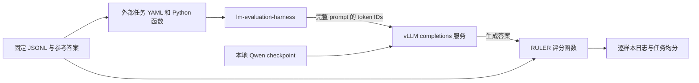

# 用自己的 Qwen3-0.6B checkpoint 跑 RULER

这套 benchmark 已通过真实 checkpoint 的端到端评测：固定 RULER JSONL → 自定义 harness 任务 → vLLM 加载本地 checkpoint → 生成答案 → 官方 RULER 评分 → 保存逐样本日志。原有 `native` 实验已完成 4k、8k、16k、32k 的全部 13 个任务，每任务 10 条。本次另用 `checkpoint_walkthrough` 实验名验证可重复执行的 4k 使用流程，不覆盖原结果。

本文使用的完整模型目录是 `/data/lpg_models/Qwen/Qwen3-0.6B`。已实测流程使用独立 vLLM 服务，换成训练后导出的完整 checkpoint 时修改服务端的 `RULER_CHECKPOINT`。harness 也支持直接通过 `pretrained` 加载 checkpoint，三种方式如下。

跨模型比较 RULER 与 LongBench v1/E/v2 时，按 [固定评测协议](LONG_CONTEXT_EVAL_PROTOCOL.md) 区分任务预算、模板、thinking、截断与评分。本文的 Qwen 专用 renderer 和 API 长度补偿不能直接照搬为其他模型的通用配置。

## 0. harness 原本如何调用 checkpoint

`--model` 选择的是 harness 的模型后端。checkpoint 目录具体传给谁，由后端决定；这三种都是 harness 自带后端。

| harness 后端 | checkpoint 参数 | 谁加载权重、执行推理 | 需要提前启动 HTTP 服务 | 本项目验证状态 |
|---|---|---|---|---|
| `hf` | `--model_args pretrained=/模型目录,...` | harness 创建 Transformers 模型，调用 `model.generate()` | 否 | 已核对固定版本源码；未运行此后端 |
| `vllm` | `--model_args pretrained=/模型目录,...` | harness 创建 `vllm.LLM`，引擎及其 worker 加载权重、执行生成 | 否 | 已核对固定版本源码；未运行此后端 |
| `local-completions` | 服务端 `--model /模型目录`；客户端 `model=qwen3-ruler` | 独立 vLLM 服务加载权重；harness 通过 HTTP 获取输出 | 是 | 已实测 4k–32k，另完成 4k 的 130 条 walkthrough |

因此，如果问题是“可以把本地 checkpoint 直接交给 lm-eval 吗”，答案是可以：用 `hf` 或 `vllm` 后端，将目录写在 `pretrained` 中。每次新启动 harness 时加载对应模型，并复用它完成该次运行的请求，不是每条样本都重新加载 checkpoint。API 方式中，客户端的 `model=qwen3-ruler` 只是服务名称，权重路径在服务启动命令里。

固定版本的实际调用位置：

- [HF 模型加载](../vendor/lm-evaluation-harness/lm_eval/models/huggingface.py)：`HFLM._create_model()` 调用 `self.AUTO_MODEL_CLASS.from_pretrained(pretrained, ...)`；Qwen3 使用 `AutoModelForCausalLM`。`generate_until()` 编码输入、预留生成长度，再由 `_model_generate()` 调用 `self.model.generate()`。
- [vLLM 模型加载](../vendor/lm-evaluation-harness/lm_eval/models/vllm_causallms.py)：`VLLM.__init__()` 将 `pretrained` 放进 `model_args["model"]`，调用 `LLM(**self.model_args)`；生成时调用引擎的 `generate()`。
- [API 后端](../vendor/lm-evaluation-harness/lm_eval/models/api_models.py)：客户端编码与提交请求，不在客户端加载模型权重。

**数据来源与模型后端是两个独立选择。** 已生成的 `ruler_local_*` 任务负责固定样本、prompt 和官方评分，三个后端都可以使用这些任务。使用本地 JSONL 不要求使用 API；使用 harness 原生 `vllm` 也不要求改回内置 `ruler` 的在线数据生成。

历史目录 `results/native/` 中的 `native` 表示“模型原生上下文范围 4k–32k”，其实际后端是 `local-completions`。它不表示曾经测试了 `--model vllm` 或 `--model hf`。

### 0.1 直接加载：`hf` 命令示例

以下两个原生加载示例按本项目固定提交的源码整理，**尚未实际运行，不能作为已有实验结果引用**。需要在同一个 Python 环境中安装 harness 和相应推理依赖。本机 API 客户端 `.venv` 没有 torch/vLLM，不能直接把其后端参数改成 `hf` 或 `vllm`；服务端 Python 已有 vLLM，但尚未确认安装 harness。

准备环境时，复用固定的 `vendor/lm-evaluation-harness` checkout，在单独的原生评测环境中安装 editable harness 及对应 extra，例如 `python -m pip install -e './vendor/lm-evaluation-harness[hf]'` 或 `python -m pip install -e './vendor/lm-evaluation-harness[vllm]'`。这里的 `python` 必须是所选环境的解释器。以下 `RULER_NATIVE_PYTHON` 需填入准备好的环境路径。

**实际依赖差异：** 此固定提交的 [pyproject.toml](../vendor/lm-evaluation-harness/pyproject.toml) 声明原生 vLLM extra 为 `vllm>=0.18`，而已实测独立服务是 0.17.1。安装 `[vllm]` 会选择符合该要求的版本，不能同时声称沿用本次服务端 0.17.1 的环境。本项目没有验证固定版本原生后端与 0.17.1 的完整兼容性。新原生环境应记录实际 harness、vLLM、PyTorch、Transformers 和 CUDA 版本，保留现有服务环境用于复用已实测流程。

在项目根目录运行，GPU 1 上评测 4k、13 任务各 10 条：

```bash
RULER_NATIVE_PYTHON=/你的评测环境/bin/python
CUDA_VISIBLE_DEVICES=1 HF_HUB_OFFLINE=1 TOKENIZERS_PARALLELISM=false \
"$RULER_NATIVE_PYTHON" -m lm_eval run \
  --model hf \
  --model_args "pretrained=/data/lpg_models/Qwen/Qwen3-0.6B,tokenizer=/data/lpg_projects/mj/test/runs/qwen3_ruler/sources/tokenizer,backend=causal,dtype=bfloat16,add_bos_token=False,max_length=4096" \
  --device cuda:0 --batch_size 1 \
  --include_path runs/qwen3_ruler/tasks \
  --tasks ruler_local_10_4096 \
  --num_fewshot 0 --seed 20261004 \
  --output_path runs/qwen3_ruler/results/qwen3_hf_example/10/4096 \
  --log_samples
```

`CUDA_VISIBLE_DEVICES=1` 后，该进程看到的 `cuda:0` 对应物理 GPU 1。此后端依赖 PyTorch/Transformers；无需启动 `serve_native.sh`。换模型时修改 `pretrained`，以新的输出目录重新启动评测。任务 YAML 已指定 `do_sample=false` 和每任务 `max_gen_toks`，同时已渲染非 thinking 模板，无需额外 `--apply_chat_template`。

### 0.2 直接加载：`vllm` 命令示例

```bash
RULER_NATIVE_PYTHON=/你的评测环境/bin/python
CUDA_VISIBLE_DEVICES=1 HF_HUB_OFFLINE=1 TOKENIZERS_PARALLELISM=false \
"$RULER_NATIVE_PYTHON" -m lm_eval run \
  --model vllm \
  --model_args "pretrained=/data/lpg_models/Qwen/Qwen3-0.6B,tokenizer=/data/lpg_projects/mj/test/runs/qwen3_ruler/sources/tokenizer,dtype=bfloat16,add_bos_token=False,max_model_len=4096,tensor_parallel_size=1,gpu_memory_utilization=0.70,max_num_seqs=4,max_num_batched_tokens=8192,generation_config=vllm,seed=20261004" \
  --batch_size 4 \
  --include_path runs/qwen3_ruler/tasks \
  --tasks ruler_local_10_4096 \
  --num_fewshot 0 --seed 20261004 \
  --output_path runs/qwen3_ruler/results/qwen3_vllm_example/10/4096 \
  --log_samples
```

此处 harness 自动创建引擎及其 worker，未使用 HTTP endpoint。`generation_config=vllm` 通过后端的 `**kwargs` 传给引擎，避免使用 checkpoint 自带的采样默认值；任务仍决定逐任务生成预算。`--batch_size 4` 是本次原生示例选择的请求批量，与已有 API 流程的 HTTP 并发参数含义不同，不能把这两个执行配置写成相同配置。

示例先使用一个 GPU、`tensor_parallel_size=1`。若要使用模型张量并行，改成例如 `CUDA_VISIBLE_DEVICES=1,3` 和 `tensor_parallel_size=2`，让一个模型的计算分布在两张卡上；对于 0.6B，本项目已实测的多卡方式是第 5 节的两个独立副本分别跑不同长度。上述原生 TP 示例也未实测。

### 0.3 三种方式共享的输入约定与结果处理

- 4k 的原生 `hf` 用 `max_length=4096`，原生 `vllm` 用 `max_model_len=4096`；API 客户端才用 `max_length=4097`，补偿固定版本 API 构造函数减 1 的行为。不能把 API 的 `L+1` 修正照搬到原生后端。vLLM 后端也不能同时传 `max_length` 与 `max_model_len`。
- 两个原生后端同样会按任务生成预算限制输入长度。复用已核对的冻结 tokenizer、禁用额外 BOS、保留现有模板，可让合法样本落在预留预算内；没有因为换后端而取消长度检查。
- 如改跑 8k/16k/32k，相应修改任务 group、后端长度参数与输出路径。50/100 条则修改 group 的样本档位和输出路径，复用现成嵌套子集。
- 本项目 `scripts/evaluate_ruler.py` 专门驱动 `local-completions`，不会通过 `--model` 参数切换为上述原生后端；原生示例直接调用 harness CLI。
- 原生 CLI 不经过脚本的已有目录检查，应为每次运行选择新的输出路径。运行完成后，可用现有汇总脚本读取相同的逐样本日志格式，例如 `.venv/bin/python scripts/summarize_results.py --experiment qwen3_vllm_example --samples 10 --lengths 4096`。该脚本核对 harness 日志中的输入和评分；HTTP endpoint probe 只适用于服务方式。

原生示例与已实测服务方式使用同一 checkpoint 和数据协议，但推理引擎运行方式、batch、环境可能不同。后端切换得到的新分数应单独记录，不能假定逐 token 输出一致。本文后续第 1–11 节记录已实测的独立服务流程。

## 1. 各部分负责什么



checkpoint 在 vLLM 服务进程里加载。harness 的 `--model local-completions` 是 API 后端，`model=qwen3-ruler` 是服务暴露的名字，不能把它理解为客户端在此处加载模型权重。实际 checkpoint 路径由服务端的 `--model` 决定。

数据已经生成，评测时不重新抽样。任务名字包含样本档位、长度及子任务，例如 `ruler_local_50_8192_qa_1`；group `ruler_local_50_8192` 包含该档位、该长度的全部 13 个任务。harness 内置 `ruler` group 使用另一套在线生成流程，本实验使用本地 `ruler_local_*` group。

一次 RULER 评测在 harness 内部的执行顺序是：

1. TaskManager 通过 `--include_path` 找到外部 YAML，展开 group 的 13 个子任务，使用 `dataset_path: json` 读取各自固定的 test JSONL。
2. `doc_to_text` 将一行样本的 input 放进 Qwen3 非 thinking 聊天模板，并在 assistant 开头接上官方 answer prefix。参考答案保留给评分函数，不拼进待评测问题；官方任务内嵌的示例本来就是输入的一部分。
3. YAML 的 `output_type: generate_until` 让任务建立生成请求；`generation_kwargs` 指定该任务的最大生成 tokens、temperature 和停止条件。框架按生成参数分组、通过选定 model backend 调用模型。
4. 本实验的 model backend 是 `local-completions`。它使用冻结 tokenizer 将 prompt 编码成 token IDs，通过 HTTP 请求调用 vLLM 的 `/v1/completions`；checkpoint 在 vLLM 里进行前向计算和逐 token 解码。
5. harness 取得返回文本后，调用任务的 `process_results(doc, results)`。本地 RULER 函数清理控制字符、比较预测与参考答案，产生每条样本的 `ruler_score`。
6. 框架对每个子任务的样本分数取均值，再按 group 配置对 13 个任务等权平均，并保存结果 JSON、逐样本 JSONL 和运行配置。整个流程没有训练或更新模型权重。

评分例子：一个 multivalue 样本要求四个值，预测包含三个，样本得 75 分；一个 QA 样本有三个正确 aliases，预测命中其中一个，样本得 100 分。生成文本也可以包含解释，当前官方指标只判断参考字符串是否出现；换成全文 exact match 会改变指标。

| 路径 | 用途 |
|---|---|
| `runs/qwen3_ruler/data/{10,50,100}/{length}/{task}.jsonl` | 固定评测样本 |
| `runs/qwen3_ruler/tasks/` | 273 个子任务 YAML、21 个 group 及评分/渲染函数 |
| `runs/qwen3_ruler/sources/tokenizer/` | 固定 tokenizer 与聊天模板 |
| `runs/qwen3_ruler/metadata/subsets.json` | 子集种子、母集索引、sample ID |
| `runs/qwen3_ruler/metadata/length_statistics.json` | 实际长度分布 |
| `runs/qwen3_ruler/results/{experiment}/{samples}/{length}/` | 模型结果与逐样本输出 |
| `runs/qwen3_ruler/logs/` | 服务和评测日志 |
| `runs/qwen3_ruler/tmp/` | 复现中间文件及废弃结果 |

## 2. 本机环境和 checkpoint

先切换到项目目录：

```bash
cd /data/lpg_projects/mj/test
```

客户端使用 `.venv/bin/python`，其中已有固定提交的 harness、transformers 和 API 依赖。服务端使用 `/home/lpg/anaconda3/bin/python`，其中已有 vLLM 和 CUDA PyTorch。两套环境按进程分开；客户端不加载模型权重，因此无需安装 torch 来调用 vLLM。

| 项目 | 本次版本 |
|---|---|
| Python | 3.13.5 |
| lm-evaluation-harness | `0.4.14.dev0`，提交 `d6de81643928d653435c431bae19945d41d32520` |
| RULER 生成器 | 提交 `c3f5e3b4f87f97e048793bb510a3a6b19a46bf3a` |
| 客户端 transformers | 4.57.1 |
| vLLM | 0.17.1 |
| 服务端 PyTorch | 2.10.0+cu128 |
| tokenizer | Qwen3-0.6B revision `c1899de289a04d12100db370d81485cdf75e47ca` |

客户端完整依赖见 `metadata/requirements.lock.txt`。该锁定文件含 editable harness 的本机绝对路径；移到新机器时，将这一项改成相同提交的本地 harness checkout 路径，然后安装。仅安装最新版 `lm-eval` 无法保证 CLI、截断处理和指标实现与本文一致。

本次验证的模型输入是 Hugging Face 完整模型目录，包含 `config.json` 和 `model.safetensors`。分片导出的完整模型也需要对应索引。LoRA adapter、训练器内部的 optimizer checkpoint 不是这次验证的输入形式，需要先按训练框架导出可加载的完整模型。

本 benchmark 固定 tokenizer。比较同架构、相同 token IDs 的 Qwen3-0.6B 训练 checkpoint 时，保留同一份数据和 tokenizer，使分数可以对应相同样本。若训练改变了词表或 token IDs，需要重新明确 tokenizer 与长度定义，不能直接声称仍是相同的 token 长度实验。

## 3. 启动 vLLM 服务

终端 A：

```bash
RULER_CHECKPOINT=/data/lpg_models/Qwen/Qwen3-0.6B \
RULER_GPU=1 \
RULER_PORT=8013 \
bash scripts/serve_native.sh
```

换 checkpoint 的实际用法：

```bash
RULER_CHECKPOINT=/你的训练输出/checkpoint-10000 \
RULER_GPU=1 \
RULER_PORT=8013 \
bash scripts/serve_native.sh
```

修改 checkpoint 后重新启动服务才能加载新权重。给客户端改一个实验名只改变结果存放位置，不会换模型。

当前脚本展开后使用以下主要参数：

```bash
/home/lpg/anaconda3/bin/python -m vllm.entrypoints.openai.api_server \
  --model /data/lpg_models/Qwen/Qwen3-0.6B \
  --tokenizer /data/lpg_projects/mj/test/runs/qwen3_ruler/sources/tokenizer \
  --served-model-name qwen3-ruler \
  --host 127.0.0.1 --port 8013 \
  --dtype bfloat16 --max-model-len 32768 \
  --gpu-memory-utilization 0.70 \
  --max-num-seqs 4 --max-num-batched-tokens 8192 \
  --generation-config vllm --seed 20261004
```

默认使用 GPU 1、端口 8013；`RULER_GPU` 和 `RULER_PORT` 可调整。`RULER_VLLM_PYTHON` 可指定已安装 vLLM 的 Python，`RULER_RUN_DIR` 可指定另一份包含 `sources/tokenizer/` 的 benchmark run。其他服务参数目前写在启动脚本中，变更时记录实际值。

等待日志出现 `Application startup complete`。初始化包含权重加载、编译和 KV cache 分配；启动后立即发请求，可能遇到连接拒绝。

终端 B 可以查看实际服务模型：

```bash
curl --noproxy '*' http://127.0.0.1:8013/v1/models
```

预期返回的模型 ID 是 `qwen3-ruler`，`root` 是实际 checkpoint 路径。不能只根据 endpoint 活着就认定它加载了新 checkpoint。

本次使用的 vLLM server 上限为 32,768。模型卡标称原生 32k，模型配置为 40,960 且没有 RoPE scaling，tokenizer 的 `model_max_length` 却写了 131,072；这三个数字含义不同。按既定实验选择只跑 4k–32k。生成了 64k/128k/256k 数据不意味着原生模型支持这些长度；本流程没有修改 RoPE 配置。

## 4. 先验证 endpoint，再跑完整 13 任务

可用各子任务最长输入检查服务端 token 计数：

```bash
.venv/bin/python scripts/probe_endpoint.py \
  --experiment qwen3_step10000 \
  --samples 10 --length 4096
```

该脚本发送每个子任务选定版本中最长样本的完整 token IDs，服务仅生成 1 token，并比较响应 `usage.prompt_tokens` 与本地计数。13 个探针的计数和 `/v1/models` 返回值保存在 `metadata/endpoint_probe_qwen3_step10000_10_4096.json`。探针只检验输入链路，不能用来计算 benchmark 分数。

然后跑 4k、每任务 10 条、全部 13 任务：

```bash
.venv/bin/python scripts/evaluate_ruler.py \
  --experiment qwen3_step10000 \
  --samples 10 \
  --lengths 4096
```

此命令会真正执行 harness `generate_until`、调用 vLLM 并评分，不是 dummy backend。输出目录为 `results/qwen3_step10000/10/4096/`，评测命令写入 `metadata/eval_commands_qwen3_step10000_10.json`，日志写入 `logs/eval_qwen3_step10000_10_4096.log`。

如果希望直接使用 harness CLI，等价配置如下。这里使用另一个实验目录，便于与脚本运行区分：

```bash
NO_PROXY=127.0.0.1,localhost \
no_proxy=127.0.0.1,localhost \
HF_HUB_OFFLINE=1 TOKENIZERS_PARALLELISM=false \
.venv/bin/python -m lm_eval run \
  --model local-completions \
  --model_args "model=qwen3-ruler,base_url=http://127.0.0.1:8013/v1/completions,tokenizer=/data/lpg_projects/mj/test/runs/qwen3_ruler/sources/tokenizer,tokenizer_backend=huggingface,tokenized_requests=True,add_bos_token=False,max_length=4097,num_concurrent=4,max_retries=1,truncate=False,seed=20261004" \
  --include_path runs/qwen3_ruler/tasks \
  --tasks ruler_local_10_4096 \
  --batch_size 1 --num_fewshot 0 --seed 20261004 \
  --output_path runs/qwen3_ruler/results/qwen3_cli_example/10/4096 \
  --log_samples
```

## 5. 扩展到全部原生长度或 50/100 条

同一服务可跑四个原生长度：

```bash
.venv/bin/python scripts/evaluate_ruler.py \
  --experiment qwen3_step10000_full \
  --samples 10 \
  --lengths 4096 8192 16384 32768
```

`--samples 50` 或 `--samples 100` 选择相应固定数据版本。不要用 `--limit 50` 代替这份 50 条数据；我们的 50 条版本有固定子集顺序和采样记录，不能用评测时临时取前若干条替换。

两个 GPU 可独立服务不同长度。在启动两个评测进程前确定长度分工，并分别命名实验：

```bash
# 终端 A：GPU 1
RULER_GPU=1 RULER_PORT=8013 RULER_CHECKPOINT=/data/lpg_models/Qwen/Qwen3-0.6B \
  bash scripts/serve_native.sh

# 终端 B：GPU 3
RULER_GPU=3 RULER_PORT=8014 RULER_CHECKPOINT=/data/lpg_models/Qwen/Qwen3-0.6B \
  bash scripts/serve_native.sh

# 终端 C
.venv/bin/python scripts/evaluate_ruler.py \
  --experiment qwen3_step10000_gpu1 --samples 10 \
  --lengths 4096 8192 16384 \
  --base-url http://127.0.0.1:8013/v1/completions

# 终端 D
.venv/bin/python scripts/evaluate_ruler.py \
  --experiment qwen3_step10000_gpu3 --samples 10 \
  --lengths 32768 \
  --base-url http://127.0.0.1:8014/v1/completions
```

这是两个模型副本分别处理数据。`--batch_size 1` 是客户端每次请求的 batch 设置，`--concurrency 4` 是评测脚本并发请求数量，服务端 `--max-num-seqs 4` 是最大并行序列数量。0.6B 模型无需为容纳权重而切成 tensor parallel；长上下文的主要显存开销还包括 KV cache。

## 6. 看结果并核对实际运行内容

```bash
.venv/bin/python scripts/summarize_results.py \
  --experiment qwen3_step10000 \
  --samples 10 --lengths 4096
```

汇总脚本支持指定 run、实验名、样本档位和长度。它读取该实验的逐样本日志，核对 13 个任务、每任务样本数、prompt 渲染、重新 token 化后的长度、生成预算和逐样本评分，再输出：

- `results/{experiment}/{samples}/summary.csv`：每个长度的任务等权均分。
- `results/{experiment}/{samples}/per_task.csv`：逐任务均分。
- `results/{experiment}/{samples}/RESULTS.md`：可阅读的结果表。
- `metadata/evaluation_validation_{experiment}_{samples}.json`：本次输入与评分核对记录。

底层 `results_*.json` 保存 harness 配置、group/子任务结果及样本数量；`samples_*.jsonl` 保存源文档、sample ID、请求参数、参考答案、模型输出和样本分数。解释失败样本时，应根据 sample ID 对应原数据和实际生成文本，而不是只看总分。

指标是官方 RULER 的不区分大小写子串命中率。QA 的多条参考答案是可接受 aliases，任意一个命中即得 100 分；NIAH、多值、变量追踪、词频任务按要求答案的命中比例计分，再对样本取均值。group 对 13 个任务等权平均，分数范围为 0–100。不要换成 strict exact match 或要求同时返回所有 QA aliases 后仍称是同一指标。

`--num_fewshot 0` 只关闭 harness 外层 few-shot。VT/CWE 的官方示例已经内嵌在数据里，不能因此把全部 13 个任务写成没有示例的 zero-shot 实验。

## 7. 实际踩坑和核对发现

以下区分了运行中实际遇到的问题和阅读固定版本源码后确定的行为，没有把未出现的假想问题当成故障。

| 问题 | 证据与影响 | 本次处理 |
|---|---|---|
| `truncate=False` 不足以防截断 | 当前 API 后端仍无条件执行 `encodings[-max_context_len:]`；源码里的超长 warning 检查在截断之后，可能看不到告警 | 数据先完整计数；客户端有效预算与数据一致；核对日志中重新 token 化的长度，并做最长输入 endpoint probe |
| 客户端 max_length 被减 1 | 固定版本 TemplateAPI 构造时保存 `max_length - 1` | 4k 传 4097，其有效预算为 4096；脚本为每个长度自动加 1。此处理针对当前固定版本 |
| model/tokenizer 的上限数字不同 | 模型卡 32k、模型 config 40960、tokenizer config 131072 | 原生评测上限固定 32768，不根据 tokenizer 数字自动跑 128k |
| 聊天模板和 thinking 改变输入协议 | 自定义任务函数已构造 Qwen3 模板，且固定 enable_thinking=False | 不再传 `--apply_chat_template`；服务用 completions endpoint 接完整 token IDs |
| 模型自带采样默认值 | 本地 generation_config 是 do_sample=true、temperature=0.6、top_k=20、top_p=0.95 | 服务设 `--generation-config vllm`；任务固定 temperature=0、do_sample=false，逐任务固定生成上限 |
| QA 指标必须处理 aliases | 官方 RULER QA 对任一 alias 命中计分；当前 harness 内置 QA helper 的部分匹配实现不等同该规则 | 本地评分函数对 QA 使用 max，其他任务按所需答案比例计分 |
| 混合结果目录 | 分卡交接中实际出现同一个 32k 目录有两套结果，包含 26 个样本文件 | 目录整体移到 run/tmp，正式结果保留一套；后续不同进程预先使用不同实验名和长度分工 |
| Git LFS 词表指针被当成 JSON | CWE 初次读取 english_words.json 时 JSONDecodeError；实际文件只是 LFS 指针 | 下载固定 RULER 提交对应的真实词表并保存在 sources |
| 旧 essay 网页并非全部 UTF-8 | 实际下载遇到 Windows-1252 标点的解码失败 | 记录逐 URL 编码；冻结原始内容与转换后的文本，全部 218 个 URL 成功后生成 |
| QA 默认取数据集开头 | 官方生成脚本按 QAS 顺序取前 100 条，未做完整验证集抽样 | 改成全体可回答 dev 问题的固定种子无放回抽样；源 ID 跨长度配对 |
| prepare.py 的成功提示不可靠 | 源码会捕获子任务异常，仍可打印 Prepare 完成信息 | 直接调用官方任务脚本，子进程 check=true；按最终行数、覆盖及预算验证产物 |
| FWE 日志中的 Logging error | 官方 `logger.info('num_example_words:', value)` 缺少占位符，产生实际 logging traceback | 数据生成继续完成；按退出码和产物区分日志格式错误与生成失败，没有据此废弃正确数据 |

prompt 检查与 endpoint probe 的证据范围不同：harness 样本日志记录的是送进后端的参数，客户端之后仍可能加工输入；长度核对依据固定后端源码确定合法样本不会被切掉，服务端探针则确认 13 个最长输入的实际 `usage.prompt_tokens`。没有声称抓取过原有 520 条评测的每条 HTTP response usage。

## 8. 长度、样本规模和论文记录

长度标签是完整 prompt 加任务最大生成 tokens 的预算上限，不是每条正文恰好达到该长度。任务包含聊天模板、问题、答案前缀和内嵌示例；官方背景生成按句子、段落或背景单位调整，实际长度会不同。

例如本次 4k、10 条版本的 QA_1 总预留长度最小 2574、均值 3489.5、最大 4096；QA_2 最小 2746、均值 3340.0、最大 3672。论文应报告实际长度统计，不能把这些输入都写成恰好 4096 tokens 的正文。

10 条版本适合打通链路和查看失败模式。50/100 条版本从同一 100 条母集固定抽取，具有嵌套关系；它们不是独立随机重复实验。13 个子任务覆盖不等同于所有 needle 深度均匀覆盖，小版本没有额外位置分层。

论文记录中应使用实际运行的 checkpoint 路径/导出标识、样本版本、长度预算及实际长度、tokenizer revision、生成器/harness/vLLM 版本、prompt 和 thinking 配置、生成上限、采样与解码种子、dtype、GPU 分工、评分方式。采样细节已写入 [EXPERIMENTAL_DETAILS.md](../runs/qwen3_ruler/EXPERIMENTAL_DETAILS.md)；服务端 `/v1/models` 记录可用于核对当前 endpoint 确实对应预期 checkpoint。

## 9. 重跑与收尾

评测脚本遇到已存在的输出目录会停止，保留原结果。换 checkpoint 或做新实验时使用新 `--experiment` 名称。若决定废弃某次结果，按项目约定将对应结果目录整体移到本 run 的 `tmp/` 再重跑，不要混用两次运行的 JSON 与样本文件。

在服务所在终端按 Ctrl-C，并等待服务退出，释放该 GPU 的模型和 KV cache。此前停服日志出现过 NCCL 的 `destroy_process_group` 告警，它发生在推理完成之后；已保存且核对通过的结果不因此变成失败结果。

本文的手工启动流程便于查看每一步。采样数据无需重复生成，直接重用固定 JSONL。只有决定重新造数据时，才按生成文档使用保存的 sources 和相同随机协议。

## 10. 本次实际运行的证据

- `metadata/checkpoint_walkthrough.json`：checkpoint 路径、启动命令、GPU/端口与运行范围。
- `metadata/checkpoint_walkthrough_config.json`、`metadata/checkpoint_walkthrough_generation_config.json`：模型配置副本。
- `metadata/endpoint_probe_checkpoint_walkthrough_10_4096.json`：13 个最长输入的服务端 token 计数。
- `metadata/eval_commands_checkpoint_walkthrough_10.json`：实际执行的完整 harness 命令。
- `metadata/evaluation_validation_checkpoint_walkthrough_10.json`：130 条样本的 prompt、预算和评分核对。
- `logs/vllm_checkpoint_walkthrough.log`、`logs/eval_checkpoint_walkthrough_10_4096.log`：服务与评测日志。
- `results/checkpoint_walkthrough/10/RESULTS.md`：本次 4k 端到端验证分数与 CSV。

原有四个原生长度的结果另见 [原生范围结果](../runs/qwen3_ruler/RESULTS.md)，不会被本次 walkthrough 覆盖。

本次 4k、13 任务各 10 条的实际均分为 **77.2051/100**。130 条样本的渲染、实际 token 化长度、预算与评分核对通过；13 个最长输入的服务端 prompt-token usage 也匹配。

## 11. 重复运行的输出差异

原有 4k 运行均分为 77.5128，本次为 77.2051。逐条比较确认 130 条样本身份、完整数据和 harness 请求参数完全一致，但 6 条预测文本不同，其中 2 条 VT 样本改变得分：

| sample ID | 原运行样本分 | 本次样本分 |
|---|---:|---:|
| `vt/4096/026` | 60 | 80 |
| `vt/4096/041` | 80 | 20 |

原始预测、参考答案与比较结果保存在 `metadata/checkpoint_walkthrough_repeat_comparison.json`。两次结果都保留，没有选择较高分覆盖另一份结果。

固定数据的可复现性与在线推理输出的逐 token 确定性是两件分别验证的事。vLLM 默认在线服务为吞吐量进行动态调度，固定 seed 与 temperature=0 不保证相同文本输出。[vLLM 0.17.1 官方复现说明](https://docs.vllm.ai/en/v0.17.1/usage/reproducibility/) 说明默认不保证复现，在线模式需要 batch invariance 才能消除调度对输出的影响，相关保证还限定同硬件和同版本。

本次服务没有启用 batch invariance；观察到的差异与默认服务的非确定性相容，但未通过受控对照定位到某个唯一调度或数值因素。本文没有把 0.3077 分的变化解释为 checkpoint 改进，也不把在线结果描述为逐字节可复现。若进一步评测严格确定性的推理配置，应使用新的实验名，记录改变后的服务参数并重新运行；本文没有执行该配置的结果。
